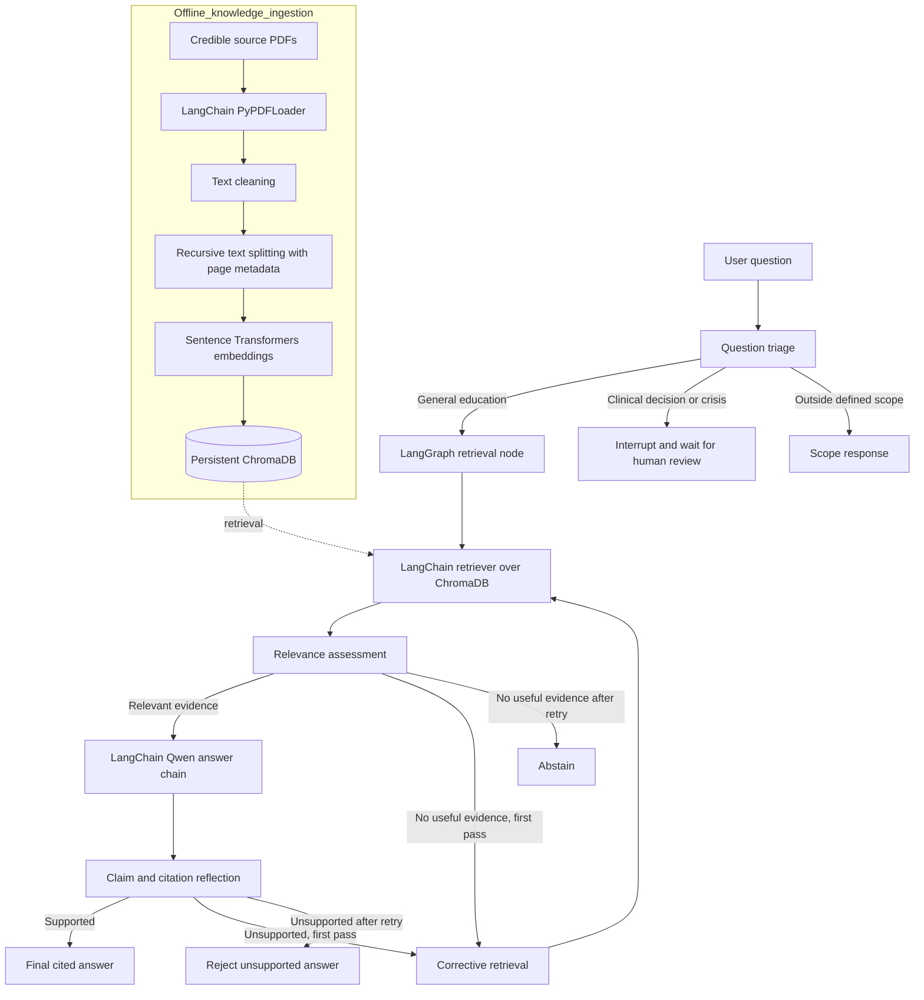

# System Architecture

## Main state

`AgentState` carries the question classification, original and corrected search queries, retry count, retrieved and accepted passages, relevance assessments, answer, claim/citation validation results, human-review flag/reason, and final response. This state passes through a compiled LangGraph `StateGraph`.

## Functional components

1. **Ingestion:** `clean_text.py` loads PDF pages through LangChain `PyPDFLoader`; `chunk_documents.py` uses `RecursiveCharacterTextSplitter` and keeps source ID, title, and 1-based page; `build_vector_db.py` embeds and stores chunks in persistent ChromaDB.
2. **Retrieval and corrective retrieval:** a LangChain `BaseRetriever` adapter returns the top passages from ChromaDB. A local Qwen relevance evaluator labels each passage as relevant, partially relevant, or irrelevant. An empty relevant set causes one corrective retrieval attempt.
3. **Generation and reflection:** a LangChain `HuggingFacePipeline` chain generates an answer from retrieved evidence. Citation assignment filters claims without lexical evidence. `answer_validator.py` checks each claim and verifies that each citation matches the source ID and page before finalizing.
4. **Safety and scope routing:** `scope_router.py` routes educational questions to RAG, pauses clinical-decision or crisis requests at a LangGraph human-review interrupt, and sends unrelated questions to an out-of-scope response.

## Trust boundaries

PDF contents and user questions are treated as data. The generator is instructed to use supplied evidence only. Generated statements are not accepted until the claim and citation checks pass. These checks reduce unsupported output but are lexical heuristics and do not replace professional judgment.
